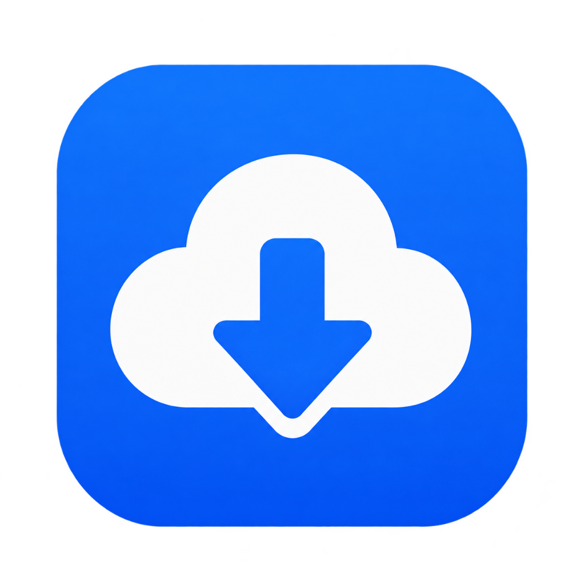
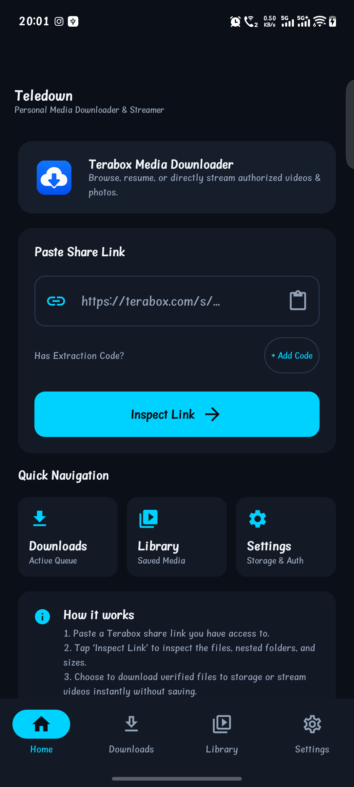
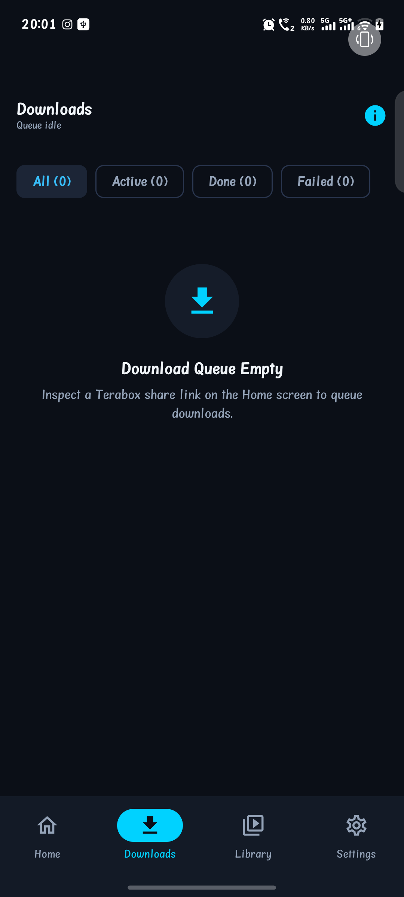
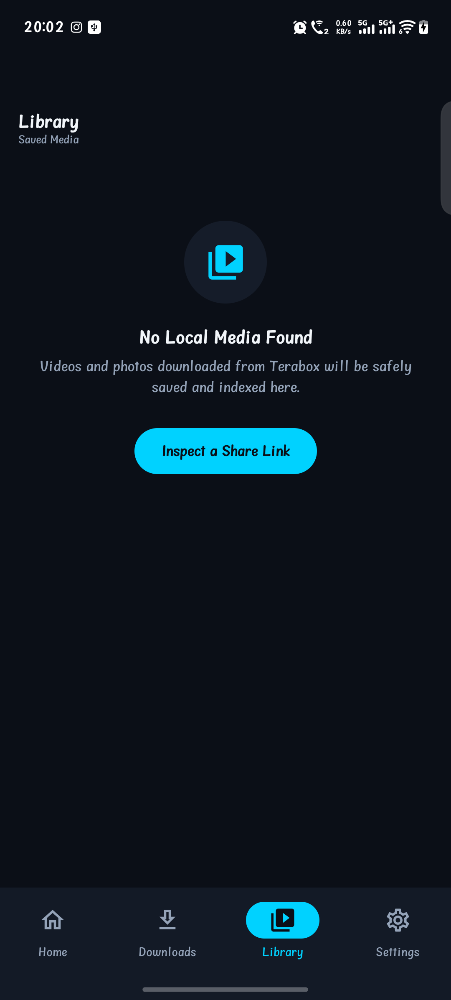
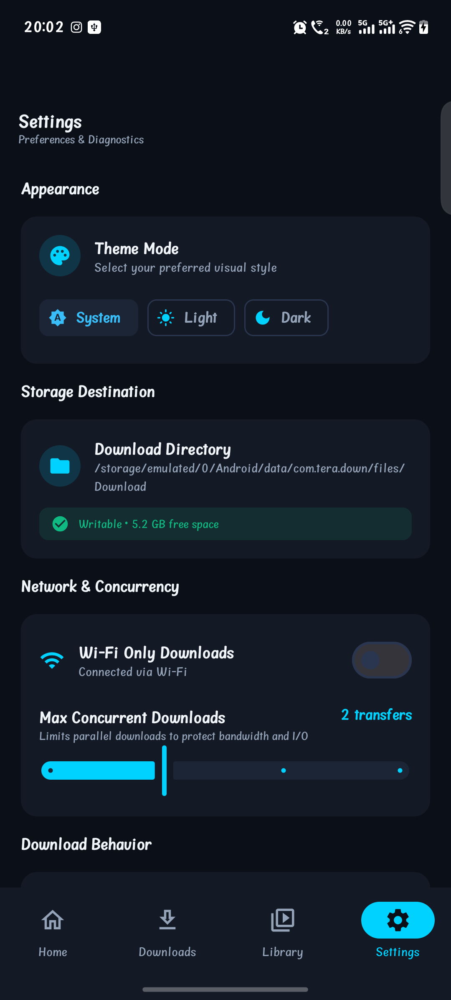

# Teledown

<p align="center">
  
</p>

<p align="center">
  <b>A clean, modern, and resilient local-first Android client for Terabox shares.</b>
</p>

---

## App Preview

<p align="center">
  
  
  
  
</p>
<p align="center">
  <sub><b>Home Screen</b> &nbsp;•&nbsp; <b>Downloads Queue</b> &nbsp;•&nbsp; <b>Media Library</b> &nbsp;•&nbsp; <b>App Settings</b></sub>
</p>

---

## What the App Does

- **Share Link Inspection:** Paste supported Terabox share links (`terabox.com`, `terabox.app`, `1024tera.com`, etc.) to parse and validate parameters.
- **Directory & File Browsing:** Traverse folder hierarchies, inspect media metadata (file name, file size, media type), and select files individually or in batches.
- **Resilient Download Engine:** Streams authorized files over HTTPS directly to device storage with monotonic progress tracking, atomic staging-to-destination finalization, and HTTP Range resume support.
- **Process Crash Recovery:** Recovers in-flight downloads after app restarts or device reboots. Tasks with partial files safely transition to `PAUSED` without corrupting files or falsely reporting completion.
- **Local Media Library:** Indexes downloaded videos and photos. Truthfully reports storage usage, detects missing files on disk, and provides instant search, filter, and sort capabilities.
- **Media3 Video Playback:** Plays completed video files locally using AndroidX Media3 (ExoPlayer) with automatic playback position tracking, debounced persistence, and end-of-video reset.
- **Audit Manifest & Safe Export:** Maintains an immutable local log of transfer attempts, errors, and outcomes with export support (JSON & CSV) and automatic redaction of sensitive query tokens (`token=***`, `sign=***`).
- **Flexible Settings:** Configurable concurrency throttling (1–5 simultaneous downloads), Wi-Fi-only network enforcement, dark/light theme switching, and custom download folder selection via Android DataStore.

---

## Implemented vs. Planned Capabilities

| Capability | Status | Implementation Details |
| :--- | :---: | :--- |
| **Share Link Parsing & Validation** | **Implemented** | Strict hostname whitelist, regex extracting `surl` and path parameters. |
| **File Browser & Batch Selection** | **Implemented** | Breadcrumb folder navigation, multi-selection, select all, media filtering. |
| **HTTP Download Engine** | **Implemented** | OkHttp-powered HTTPS streaming, atomic temp-file finalization, Range resume. |
| **Download Queue & State Validator** | **Implemented** | Strict state machine (`QUEUED`, `DOWNLOADING`, `PAUSED`, `COMPLETED`, `CANCELLED`, `FAILED`). |
| **Background Service & Notifications** | **Implemented** | Foreground service with `dataSync` type, progress notifications, and action receivers. |
| **Crash Recovery Manager** | **Implemented** | Disk reconciliation identifying verified completed vs partial staging files. |
| **Local Media Library & Safe Actions** | **Implemented** | Separate "Remove Record Only" vs "Delete from Disk" with confirmation dialogs. |
| **Media3 Local Video Player** | **Implemented** | ExoPlayer with position tracking, error fallback, and aspect ratio controls. |
| **Activity Manifest & Redacted Export** | **Implemented** | Structured event logging with JSON/CSV export and token parameter sanitization. |
| **Settings Storage** | **Implemented** | Persistent settings stored via Jetpack DataStore Preferences. |
| **Live Terabox Dynamic Anti-Bot / CAPTCHA** | **Not Implemented** | Does **not** bypass CAPTCHA, bot challenges, paywalls, or private access limits. |
| **Cloud Synchronization / Remote Accounts** | **Not Implemented** | App is 100% local-first; no remote user database, analytics, or third-party servers. |

---

## Architecture Overview

Teledown follows the **Clean Architecture & Unidirectional Data Flow (UDF)** patterns:

```
UI Layer (Jetpack Compose Screens & ViewModels)
  │
  ├──> Feature Layer (BrowseShare, Downloader, Library, Manifest, Settings, Player)
  │      │
  │      ├──> Domain / Business Logic (State Validators, Recovery, Trackers, Sanitizers)
  │      │
  │      └──> Repository Layer (DownloadQueueRepo, LibraryRepo, ManifestRepo, SettingsRepo)
  │             │
  │             ├──> Local Persistence (Room Database & Jetpack DataStore)
  │             └──> Network Engine (OkHttp Client & ShareLinkResolver)
```

- **Application ID / Namespace:** `com.tera.down`
- **Application Label:** `Teledown`
- **Minimum SDK:** API 26 (Android 8.0 Oreo)
- **Target SDK:** API 35 (Android 15)

---

## Main Technologies & Dependencies

- **Language:** Kotlin 2.0.21
- **UI Toolkit:** Jetpack Compose (BOM `2024.10.00`), Material 3
- **Local Database:** Room `2.6.1` with KSP compiler
- **Preferences:** Jetpack DataStore Preferences `1.1.1`
- **Networking:** OkHttp `4.12.0`
- **Media Playback:** AndroidX Media3 (ExoPlayer, UI, Common) `1.4.1`
- **Coroutines & Asynchronous Flows:** Kotlinx Coroutines `1.9.0`
- **Serialization:** Kotlinx Serialization JSON `1.7.3`
- **Unit & Integration Testing:** JUnit 4, Kotlinx Coroutines Test, MockWebServer `4.12.0`, AndroidX Room Testing, AndroidX Test Core

---

## How to Open and Build the Project

### Prerequisites
- **Android Studio:** Ladybug (2024.2.1) or newer.
- **JDK:** OpenJDK 17 or newer.
- **Android SDK:** Platforms 26 through 35, Android Build Tools 35.0.0.

### Build Commands
Clone the repository:
```bash
git clone https://github.com/Pranjalbudaniya/teradown.git
cd teradown
```

Build the debug APK:
```bash
./gradlew assembleDebug
```
The output APK is generated at:
`app/build/outputs/apk/debug/app-debug.apk`

Build an unsigned release APK:
```bash
./gradlew assembleRelease
```
The output APK is generated at:
`app/build/outputs/apk/release/app-release-unsigned.apk`

---

## How to Run Tests

Run all unit tests and automated integration workflows:
```bash
./gradlew testDebugUnitTest
```
*Current test suite: **259 tests**, 100% pass rate.*

Run static analysis and linting:
```bash
./gradlew lintDebug
```

---

## How to Install a Locally Built Debug APK

Ensure an Android device or emulator with USB debugging enabled is connected (`adb devices`), then run:

```bash
adb install -r app/build/outputs/apk/debug/app-debug.apk
```

Or run directly from Gradle:
```bash
./gradlew installDebug
```

---

## Privacy and Data Storage Summary

- **Local Storage:** All app state (download queue, library index, manifest logs, and settings) resides exclusively in the private Room SQLite database and DataStore files on the device.
- **No Backend:** Teledown contains **no custom backend**, telemetry, crash analytics, or tracking libraries.
- **Sensitive Parameter Redaction:** When exporting manifest logs or displaying URLs, query parameters such as `token`, `sign`, `key`, `auth`, `password`, and `session` are automatically masked to prevent unintentional credential sharing.
- **File Safety:** Deleting a library entry only deletes the database record by default. Physical file deletion requires an explicit, separate confirmation step.

---

## Known Limitations

1. **Terabox Anti-Bot & Private Shares:** Live Terabox endpoints frequently require interactive web sessions, dynamic JavaScript execution, or CAPTCHA solving. Teledown does not contain browser automation or CAPTCHA-bypass algorithms. If a share requires authentication or interactive verification, the resolver cleanly returns an `AUTH_REQUIRED` or `UNSUPPORTED_ACCESS_FLOW` error.
2. **Server-Side Download Restrictions:** Download speeds and resumption capability depend strictly on Terabox CDN servers supporting HTTP 206 `Content-Range` headers.
3. **Storage Access Framework (SAF):** Custom download directories configured outside standard app-specific external storage require runtime folder access grants via the system document tree picker.
