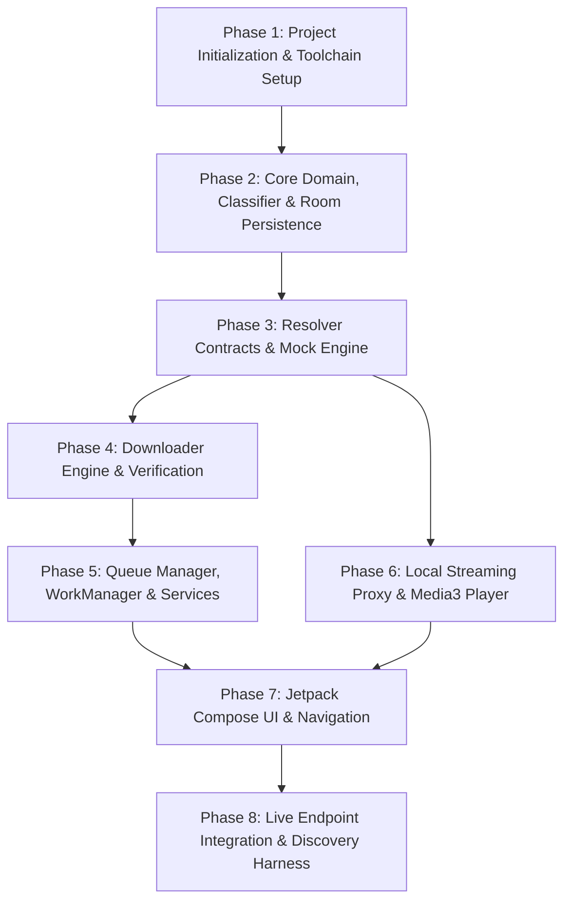

# Terabox Android Downloader & Streamer: Architecture & Implementation Plan

**Document Version:** 1.0.0  
**Status:** Approved for Review (Prompt 1 Deliverable)  
**Target Platform:** Android (API Level 26+ / Android 8.0 to Android 15+)  
**Primary Specification:** [`terabox_downloader_logic.md`](file:///home/pranjal/Vibe/teledown/terabox_downloader_logic.md)

---

## 1. Existing Project Assessment

### 1.1 Workspace State
- **Workspace Location:** `/home/pranjal/Vibe/teledown`
- **Initial State:** The workspace directory was initialized without any pre-existing files or Android project scaffolding.
- **Specification Source:** Found at `/home/pranjal/Downloads/terabox_downloader_logic.md` and safely mirrored into the workspace root at [`terabox_downloader_logic.md`](file:///home/pranjal/Vibe/teledown/terabox_downloader_logic.md).
- **Existing Android Files:** None. No `build.gradle.kts`, `settings.gradle.kts`, `gradlew`, or `AndroidManifest.xml` exist in this repository yet.

### 1.2 Development Environment & Host Tooling
- **Java Virtual Machine:** OpenJDK 21.0.12.1 (`/usr/bin/java`)
- **Android SDK:** Installed at `/home/pranjal/Android/Sdk`
- **Installed Android Platforms:** `android-35` (Android 15), `android-36`, `android-37`
- **Installed Build Tools:** `34.0.0`, `36.0.0`
- **Git Version Control:** `/usr/bin/git` available

### 1.3 Recommended Baseline Target Configuration
| Configuration Item | Recommended Value | Rationale |
|---|---|---|
| **Package Name** | `com.tera.down` | Clean, reverse-DNS identifier for application ID and namespaces |
| **Compile SDK** | `35` (Android 15) | Matches installed SDK platform and modern Jetpack libraries |
| **Target SDK** | `35` (Android 15) | Modern behavior, predictive back, Android 15 edge-to-edge enforcement |
| **Min SDK** | `26` (Android 8.0) | Covers >98% of active devices; native `java.time`, notification channels, modern storage |
| **Kotlin Version** | `2.0.21` or `2.1.0` | Latest stable with Kotlin Compose compiler plugin |
| **Android Gradle Plugin (AGP)** | `8.7.2`+ | Stable modern Gradle plugin compatible with JDK 21 |
| **Gradle Wrapper** | `8.10.2`+ | Supports JDK 21 and AGP 8.7+ |

---

## 2. Summary of Specification Requirements (`terabox_downloader_logic.md`)

The specification defines a strictly disciplined, personal-use media downloader and direct streamer with rigid boundaries:

1. **Scope & Ground Rules:**
   - Supports single files, flat folders, and nested folders from Terabox share links (`terabox.com/s/...`, `?surl=...`, mirror domains).
   - Only processes videos and photos; unsupported files are counted and skipped (`SKIPPED_TYPE`).
   - Downloads must be strictly resumable with Range headers (`bytes=offset-`).
   - Upstream links expire quickly; links must be refreshed automatically up to 3 times per file.
   - Strictly out-of-scope: Captcha/paywall bypass, multi-connection parallel range splitting (no speed cheating), stream ripping when no direct download link is provided, and credential hijacking.
2. **Status & State Machine:**
   - **Share-level:** `OK`, `NEEDS_PASSWORD`, `WRONG_PASSWORD`, `NOT_LOGGED_IN`, `EXPIRED`, `CANCELLED`, `BLOCKED`, `CAPTCHA_OR_RATELIMIT`.
   - **File-level:** `PENDING`, `DOWNLOADING`, `DONE`, `SKIPPED_EXISTS`, `SKIPPED_EMPTY`, `SKIPPED_TYPE`, `NO_DIRECT_LINK`, `MISSING`, `BLOCKED`, `FAILED_LINK_EXPIRED`, `FAILED_SIZE`, `FAILED_NETWORK`, `QUOTA_PAUSED`, `NEEDS_AUTH`, `DISK_FULL`, `LIST_FAILED`.
   - **Queue-wide pause triggers:** `NEEDS_AUTH`, `QUOTA_PAUSED`, `DISK_FULL`, `EXPIRED`.
3. **Download Protocol & Verification:**
   - Pre-flight probe with `Range: bytes=0-0` (HEAD is unreliable).
   - Inspect Content-Type: reject HTML/JSON error bodies.
   - Chunked transfer into `.part` temporary file; periodic flush and offset persistence (every ~8 MB).
   - Post-download verification: Exact size match, magic-byte inspection (e.g., MP4 `ftyp` at offset 4, JPEG `FF D8`, PNG `89 50 4E 47`), MD5 check (warning-only), followed by atomic rename from `.part` to final filename.
4. **Local Streaming Proxy (Section 16):**
   - Bind HTTP server strictly to `127.0.0.1` on an ephemeral port with an unguessable 128-bit security token.
   - Stream media directly to an internal player (Media3 / ExoPlayer) translating byte-range requests upstream with session headers.
   - Refreshes upstream expired links transparently mid-stream without restarting the media player.
   - Leaves 0 bytes saved on disk; isolates credentials from the media player.

---

## 3. Modular Architecture & Package Layout

To ensure strict separation of concerns, testability, and adherence to the rule that all Terabox-specific network knowledge stays isolated, we propose a modular architecture with either multi-module Gradle or well-defined decoupled packages:

```
teledown/
├── app/
│   ├── src/main/java/com/teledown/app/
│   │   ├── di/                   # Dependency Injection (Hilt or Koin)
│   │   ├── MainActivity.kt       # Single-activity Compose entry point
│   │   └── TeledownApp.kt        # Application class, notification channels, worker factory
├── core/
│   ├── model/                    # Shared immutable domain models & enums
│   │   ├── ShareInfo.kt
│   │   ├── ShareEntry.kt
│   │   ├── DownloadTask.kt
│   │   ├── FileStatus.kt
│   │   ├── ShareState.kt
│   │   └── MediaType.kt
│   ├── database/                 # Room database (replaces/supplements manifest.json)
│   │   ├── AppDatabase.kt
│   │   ├── dao/
│   │   │   ├── ShareDao.kt
│   │   │   └── DownloadTaskDao.kt
│   │   └── entity/
│   │       ├── ShareEntity.kt
│   │       └── DownloadTaskEntity.kt
│   └── network/                  # Shared OkHttpClient, interceptors, secure storage
│       ├── NetworkClient.kt
│       ├── ScrubbingLoggingInterceptor.kt
│       └── SecureCookieStorage.kt
├── feature/
│   ├── resolver/                 # ISOLATED: Terabox endpoints, signing, parsing
│   │   ├── TeraboxUrlParser.kt   # Parse surl, pwd, mirror domains
│   │   ├── TeraboxResolver.kt    # Interface for share info, folder walk, dlink resolution
│   │   ├── TeraboxResolverImpl.kt# Concrete network implementation (isolated)
│   │   ├── MockTeraboxResolver.kt# Fixture-based mock for testing & offline dev
│   │   └── model/                # Raw API DTOs and errno definitions
│   ├── classifier/               # File extension & category classification
│   │   └── MediaClassifier.kt    # Video / Photo / Unsupported determination
│   ├── downloader/               # Safe, chunked, resumable file download engine
│   │   ├── FileDownloader.kt
│   │   ├── ResumableStreamEngine.kt
│   │   ├── MagicByteValidator.kt
│   │   ├── BackoffPolicy.kt
│   │   └── StorageTargetWriter.kt# Scoped Storage & POSIX .part abstraction
│   ├── queue/                    # Concurrency, pause/resume, WorkManager & Foreground Service
│   │   ├── DownloadQueueManager.kt
│   │   ├── DownloadWorker.kt     # WorkManager CoroutineWorker
│   │   ├── DownloadService.kt    # Ongoing Foreground Service with notifications
│   │   └── QueueNotificationManager.kt
│   ├── manifest/                 # Spec compatibility: JSON import/export
│   │   ├── ManifestExporter.kt   # Syncs Room DB with manifest.json & report.json
│   │   └── ManifestImporter.kt
│   ├── reporter/                 # Real-time and run-completion reporting
│   │   └── DownloadReporter.kt   # Aggregates totals, errors, skipped counts
│   ├── streamer/                 # Section 16: Local HTTP Streaming Proxy
│   │   ├── LocalStreamingProxy.kt# 127.0.0.1 ephemeral HTTP server
│   │   ├── StreamSession.kt      # Range translation & transparent link refresh
│   │   └── DnsRebindingGuard.kt  # Host header & token validation
│   └── ui/                       # Jetpack Compose UI (Material 3)
│       ├── navigation/           # Compose Navigation destinations
│       ├── theme/                # Typography, ColorScheme, Glassmorphism styles
│       ├── browse/               # Share link entry, folder explorer, selection
│       ├── queue/                # Active downloads, speed, pause/resume, retry
│       ├── player/               # Media3 / ExoPlayer video playback screen
│       └── settings/             # Cookie input, workers, storage directory
```

---

## 4. Android Component Recommendations & Mapping

| Spec Responsibility | Android Component | Technical Rationale |
|---|---|---|
| **Asynchronous Concurrency** | Kotlin Coroutines & `Flow` / `StateFlow` | Lightweight worker scheduling, cancellation propagation, structured concurrency. |
| **Worker Synchronization** | Kotlin Coroutine `Mutex` & `Semaphore` | Strict rate/worker limiting: 2 video workers (max 4), 4 photo workers. Single-flight link refresh lock. |
| **Local Persistence / State** | **Room Database** + **JSON Manifest Export** | Room provides reactive `Flow` queries to Compose UI, transaction safety, and indexed queries. An adapter exports/imports `manifest.json` and `report.json` to retain 100% spec compatibility. |
| **Secure Cookie Storage** | **Jetpack Security** (`EncryptedSharedPreferences`) | Cookies are encrypted at rest with hardware-backed Android KeyStore keys. Never plain-text in SharedPreferences or SQLite. |
| **HTTP Engine** | **OkHttp 4.12+** | Robust HTTP/1.1 and HTTP/2 connection pooling, streaming response bodies, custom Range headers, and interceptor hooks. |
| **Background Execution** | **WorkManager** + **Foreground Service** | Reliable execution. Ongoing Foreground Service (`foregroundServiceType="dataSync"`) ensures active downloads continue without OS termination. WorkManager guarantees queue resumption across process deaths. |
| **Media Playback** | **AndroidX Media3 (ExoPlayer)** (`1.4+`) | Modern standard for Android media playback. Integrates seamlessly with Compose (`PlayerView`), handles seek events, audio focus, and custom datasources. |
| **UI Framework** | **Jetpack Compose (Material 3)** | Declarative, modern UI with smooth micro-animations, adaptive layout, and reactive StateFlow binding. |
| **Dependency Injection** | **Hilt** or **Koin** | Ensures clean decoupling between `TeraboxResolver` interface and `DownloadQueueManager` / UI ViewModels. Simplifies unit test mocking. |

---

## 5. Android-Specific Platform Constraints & Solutions

### 5.1 Background Execution & Doze Mode
- **Constraint:** Android 12+ restricts starting foreground services from the background and Android 14+ requires explicit `foregroundServiceType` declarations with valid permissions (`FOREGROUND_SERVICE_DATA_SYNC`).
- **Solution:** 
  - Downloads initiated in UI start a Foreground Service immediately while the app is in the foreground.
  - The notification features live progress, download speed, and `Action` buttons for **Pause**, **Resume**, and **Cancel**.
  - On Android 13+ (API 33), runtime permission `POST_NOTIFICATIONS` is checked before starting the download queue.
  - WorkManager handles periodic retry and queue resuscitation if network transitions occur.

### 5.2 Scoped Storage, SAF, and MediaStore
- **Constraint:** On Android 10+ (API 29+), raw POSIX file paths to public directories are restricted. Appending ranges to files directly via `ContentResolver` on MediaStore is error-prone.
- **Solution:** Two-tier storage strategy:
  1. **Working Staging Directory:** All `.part` files are created in the app's external files directory (`context.getExternalFilesDir(Environment.DIRECTORY_DOWNLOADS)`). This allows standard, high-performance POSIX I/O (`RandomAccessFile`, `FileChannel`, direct `fsync`, atomic rename).
  2. **Final Export / Publishing:** Once the file is fully downloaded, verified by size, and validated via magic bytes, it is either moved atomically within app storage or published to the public `MediaStore` (`Download/` or `Movies/` / `Pictures/`) using `MediaStore.Downloads` or via SAF (`Storage Access Framework`) if the user selected a custom external directory.

### 5.3 Network Security & Localhost Streaming
- **Constraint:** Android 9+ (API 28+) blocks cleartext HTTP by default. The local streaming proxy listens on `127.0.0.1` over HTTP, which ExoPlayer must access.
- **Solution:** Configure `res/xml/network_security_config.xml`:
  ```xml
  <?xml version="1.0" encoding="utf-8"?>
  <network-security-config>
      <domain-config cleartextTrafficPermitted="true">
          <domain includeSubdomains="true">127.0.0.1</domain>
          <domain includeSubdomains="true">localhost</domain>
      </domain-config>
  </network-security-config>
  ```
  All remote traffic (Terabox API and CDN direct links) remains strictly HTTPS.

### 5.4 Privacy & Credential Security
- **Constraint:** Terabox cookies grant full account access and must never leak.
- **Solution:** 
  - Build a custom `ScrubbingLoggingInterceptor` that strips `Cookie`, `Set-Cookie`, `sign`, `token`, and `dlink` query parameters from all logs.
  - Ephemeral streaming tokens (128-bit) are generated per session and verified on every local HTTP request. Host header is strictly validated to prevent DNS rebinding attacks.

---

## 6. Implementation Feasibility: Local vs. Live Endpoint Validation

| Component / Requirement | Local Testability (Offline) | Requires Live Terabox Account / Endpoints | Notes |
|---|---|---|---|
| **Link Parser** (`surl`, `pwd`, mirror domains) | 100% Local Unit Tests | None | Pure string & URI manipulation logic |
| **Media Classifier** (video, photo, other) | 100% Local Unit Tests | Category code confirmation | Extension matching is 100% local; numeric category mapping requires live data |
| **Downloader Engine** (Range, 206, 416, resume) | 100% Local via `MockWebServer` | None | Can test all edge cases with OkHttp MockWebServer |
| **Magic-Byte Validator** (MP4, JPG, PNG) | 100% Local Unit Tests | None | Fixture byte arrays |
| **Queue Manager & Concurrency** | 100% Local Unit/Integration Tests | None | Virtual time coroutine testing |
| **Room Database & Manifest Exporter** | 100% Local Unit Tests | None | Room in-memory database tests |
| **Local Streaming Proxy & ExoPlayer** | 100% Local Integration Tests | None | Mock upstream server feeding the local proxy |
| **Compose UI & Navigation** | 100% Local UI Tests & Previews | None | Mock ViewModels and fixtures |
| **Live Share Info API** | Needs Fixtures | **Required for Live Use** | Endpoint path, sign algorithm, CSRF tokens |
| **Live Folder Listing API** | Needs Fixtures | **Required for Live Use** | Query params (`dir`, `page`, `num`, order) |
| **Live Direct Link (`dlink`) Resolution** | Needs Fixtures | **Required for Live Use** | Method to obtain authorized download URL |
| **Error Code Mapping (`errno`)** | Needs Fixtures | **Required for Live Use** | Discover and map proprietary `errno` numbers |

---

## 7. Phased Implementation Plan



### Phase 1: Project Initialization & Gradle Scaffolding
- Initialize root Gradle files (`settings.gradle.kts`, `build.gradle.kts`, `gradle.properties`, wrapper).
- Configure version catalog (`gradle/libs.versions.toml`) with Kotlin 2.0, Compose BOM, Room, WorkManager, OkHttp, Media3, and Coroutines.
- Set up target SDK 35, compile SDK 35, min SDK 26, Java 21 toolchain compatibility.
- Configure `AndroidManifest.xml` with permissions (`INTERNET`, `FOREGROUND_SERVICE`, `FOREGROUND_SERVICE_DATA_SYNC`, `POST_NOTIFICATIONS`) and `network_security_config.xml`.

### Phase 2: Core Domain Models, Media Classifier & Persistence
- Implement core data classes in `core.model`: `ShareInfo`, `ShareEntry`, `DownloadTask`, `FileStatus`, `ShareState`, `MediaType`.
- Implement `MediaClassifier`: comprehensive extension parsing with unit tests.
- Set up Room Database (`AppDatabase`) with `ShareEntity` and `DownloadTaskEntity`.
- Create `ManifestExporter` / `ManifestImporter` to maintain exact compatibility with `manifest.json` and `report.json`.
- Write unit tests for classifier and Room DAOs.

### Phase 3: Resolver Architecture & Mock Engine
- Define `TeraboxResolver` interface: `parseLink`, `getShareInfo`, `walkFolder`, `resolveDirectLink`.
- Implement `TeraboxUrlParser` with support for all mirror domains (`terabox.com`, `teraboxapp.com`, `1024tera.com`, `mirrobox.com`, etc.), `surl` leading `1` stripping/preservation, and `pwd` query extraction.
- Implement `MockTeraboxResolver` loaded with mock fixtures (single file, nested folder, pagination, password required, expired share) to enable complete offline development and UI previewing.

### Phase 4: Safe, Resumable Downloader Engine
- Implement `FileDownloader` using OkHttp streaming.
- Implement pre-flight probe (`Range: bytes=0-0`), Content-Type validation, and Content-Range total size parsing.
- Implement `.part` file resumption, Range 200 truncate-to-zero handling, Range 416 validation.
- Implement `MagicByteValidator` for MP4 (`ftyp`), JPG (`FF D8`), PNG (`89 50 4E 47`).
- Implement `BackoffPolicy` (exponential backoff with jitter, honoring `Retry-After`).
- Write comprehensive tests against `MockWebServer`.

### Phase 5: Queue Manager, WorkManager & Foreground Notification Service
- Implement `DownloadQueueManager`: concurrency controls (2 video workers, 4 photo workers), state transitions, and pause/resume logic.
- Handle queue-wide pause triggers (`NEEDS_AUTH`, `QUOTA_PAUSED`, `DISK_FULL`, `EXPIRED`).
- Implement `DownloadForegroundService` with notification channel, progress bar, cancel/pause actions.
- Implement `DownloadWorker` via WorkManager for resilience against background termination.
- Implement `DownloadReporter` for aggregate stats and `report.json` generation.

### Phase 6: Local Streaming Proxy & Media3 Video Player
- Implement `LocalStreamingProxy` using lightweight embedded HTTP server on `127.0.0.1` with dynamic port.
- Implement `StreamSession` with upstream Range forwarding, read-ahead buffer (16 MB), and transparent link refresh on 403/410.
- Implement DNS-rebinding guard (`Host` header check) and token validation.
- Implement Compose `VideoPlayerScreen` powered by `androidx.media3.ui.PlayerView` and ExoPlayer.

### Phase 7: Jetpack Compose User Interface (Material 3)
- Build Theme system (Dark mode, glassmorphism, accent colors, modern typography).
- Build **Link Input Screen**: paste URL, password prompt dialog, cookie status chip.
- Build **Share Explorer Screen**: folder tree navigation, breadcrumb header, multi-select, filter chips (Videos, Photos), "Download Selected" and "Stream Video" actions.
- Build **Download Queue Screen**: active tasks, speed metrics, progress bars, pause/resume/cancel controls, and retry-failed action.
- Build **Settings Screen**: secure cookie entry, storage path selection, worker count sliders.

### Phase 8: Live Endpoint Integration & Discovery Tooling
- Build `DiscoveryDoctor` utility in the app to inspect live network behavior and record endpoint mappings.
- Implement concrete `TeraboxResolverImpl` adhering strictly to verified findings in `docs/endpoints.md`.
- Validate with authorized personal accounts.

---

## 8. Risks, Unresolved Questions & Mitigation

### 8.1 Risks & Mitigations
1. **Endpoint Drift & Undocumented APIs:**
   - *Risk:* Terabox changes internal JSON keys, tokens, or encryption signatures unexpectedly.
   - *Mitigation:* Strict isolation of `TeraboxResolver`. The rest of the app interacts solely with domain models. The app can switch to an updated resolver or web-session-based parser without altering downloader, queue, or UI logic.
2. **Aggressive Android Battery Optimization / OEM Doze:**
   - *Risk:* Chinese OEM ROMs (Xiaomi, Huawei, Samsung) may kill long-running download services.
   - *Mitigation:* Foreground service with active notification + prompt user to exclude app from battery optimization (`REQUEST_IGNORE_BATTERY_OPTIMIZATIONS`) + WorkManager periodic health check.
3. **Session Cookie Invalidation Mid-Run:**
   - *Risk:* Long batch downloads might exceed cookie lifetime, triggering 401/403.
   - *Mitigation:* The queue enters `NEEDS_AUTH`, pauses all workers without discarding `.part` progress, and alerts the user to update the session cookie in Settings.

### 8.2 Unresolved Questions & Validation Requirements
1. **Live Terabox Endpoint Signatures:**
   - What are the current live URL paths and required request headers (e.g., `User-Agent`, `Referer`, `jsToken`, `dp-logid`) for `shorturlinfo` and folder listing?
   - *Action:* Perform browser Network inspection using personal authorized account as outlined in Section 13 of the spec, and document in `docs/endpoints.md`.
2. **Numeric Category IDs:**
   - Does Terabox consistently return `1` for video and `3` for photo across all regions/mirrors?
   - *Action:* Rely on file extension as the primary source of truth, using category solely as fallback.
3. **Storage Destination Preference:**
   - Should default downloads go to the app's scoped external files directory (automatic, no permission prompts) or directly to the public `Download/` folder via MediaStore/SAF?
   - *Action:* Default to App-External Storage for rock-solid `.part` staging, with an option in Settings to export completed files to public storage.

---

## 9. Pre-Implementation Test Matrix

Before writing production networking and database code in Phase 2+, the following unit test suites will be constructed:

1. **`TeraboxUrlParserTest`**:
   - `/s/1abcdef` (with leading 1)
   - `/s/abcdef` (without leading 1)
   - `?surl=1abcdef` and `?surl=abcdef`
   - Password parsing: `?pwd=xyz1`
   - Mirror domains: `1024tera.com`, `teraboxapp.com`, `mirrobox.com`, `dubox.com`
2. **`MediaClassifierTest`**:
   - Case-insensitive video extensions (`.MP4`, `.mkv`, `.MOV`, `.webm`)
   - Case-insensitive photo extensions (`.JPG`, `.jpeg`, `.png`, `.heic`, `.webp`)
   - Unknown extensions (`.zip`, `.exe`, `.pdf`) -> `UNSUPPORTED`
   - Fallback category numbers when extension is missing
3. **`BackoffPolicyTest`**:
   - Exponential progression: 1s, 2s, 4s, 8s, up to 60s cap
   - Jitter variance
   - Reset on byte transfer success
4. **`MagicByteValidatorTest`**:
   - Valid MP4 (`ftyp` header at byte 4)
   - Valid JPEG (`FF D8 FF`)
   - Valid PNG (`89 50 4E 47`)
   - Corrupted or HTML error body payload -> fails validation
5. **`MockDownloaderResumeTest`**:
   - Simulated 206 Partial Content appending to `.part` file
   - Simulated 200 OK on range request triggering truncate and re-download
   - Simulated 416 Range Not Satisfiable handling

---

## 10. Checklist for Next Step (Prompt 2 Readiness)

- [x] Workspace inspected and environment analyzed.
- [x] `terabox_downloader_logic.md` thoroughly reviewed and summarized.
- [x] Modular architecture designed with strict isolation of Terabox endpoints.
- [x] Android components mapped (Coroutines, Room, WorkManager, OkHttp, Media3, Compose).
- [x] Android platform constraints analyzed (Background execution, Scoped Storage, Cleartext HTTP for localhost proxy, Cookie security).
- [x] Implementation plan structured into 8 modular phases.
- [x] Architecture & Implementation plan saved to [`docs/implementation_plan.md`](file:///home/pranjal/Vibe/teledown/docs/implementation_plan.md).
- [ ] **Awaiting user approval before proceeding to project initialization and implementation (Prompt 2).**
